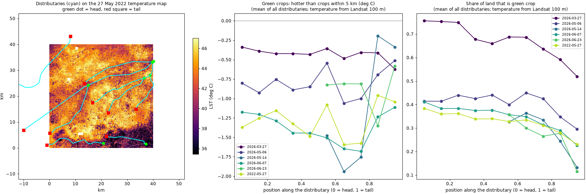

# lst_downscale

**Sharpening satellite land surface temperature from 1 km to 10 m over Lahore, and checking how much
of the added detail is real.**

Sentinel-3 measures the temperature of the ground every day, but on 1 km pixels: one pixel covers
dozens of fields. This project sharpens it to 10 m with Sentinel-2 as the guide (what is in each 10 m
pixel), checks the result against Landsat's own 100 m thermal measurement, and uses it on a real
question: do crops at the tail of a canal show signs of water shortage? Study areas: farmland south
of Lahore around the fields of [crop_project](https://github.com/mburhankhan101-glitch/crop_project),
and Lahore district, including the May 2022 heatwave.


## Key results

"Detail r" is how much of the temperature pattern inside each 1 km pixel the sharpened map gets right,
checked at 100 m against Landsat (0 = none: plain enlargement; 1 = all). Test A sharpens Landsat
averaged to 1 km, so the truth is known; Test B sharpens real Sentinel-3.

| Method | Detail r, Test A | Detail r, Test B (real Sentinel-3) | Error of the pattern, Test B |
|---|---|---|---|
| Enlarge the 1 km pixels (no guide) | 0.30 | 0.22 | 1.84 deg C |
| TsHARP (one NDVI line) | 0.69 | 0.69 | 1.45 deg C |
| **Random forest + smooth correction** | **0.78** | **0.72** | **1.32 deg C** |

Mean of five spring 2026 dates over farmland. On 27 May 2022, with all three satellites within two
minutes of each other, the random forest reached 0.82 and 0.78 over farmland, and 0.68 and 0.63 over
Lahore district.

| Guide image for 27 May 2022 (Test B, detail r) | Farmland | Central Lahore |
|---|---|---|
| Sentinel-2 of the same day | 0.78 | 0.55 |
| Composite of +-30 days | 0.71 | 0.59 |
| Composite of the month before | 0.49 | 0.36 |

| Canal distributaries, head third vs tail third | Result |
|---|---|
| Share of land in green crop | lower at the tail on 27 of 32 distributary-dates; beyond chance in March (p = 0.04), borderline in June (0.06) |
| Temperature of the green crops | no difference beyond chance on any date |

## Main findings

1. **A random forest on all Sentinel-2 bands recovers most of the detail** inside a 1 km pixel over
   farmland (about three quarters) and cuts its error by about 30% against plain enlargement.
2. **Moisture matters more than greenness.** The shortwave infrared band and the moisture index were the
   model's most important inputs, not NDVI: evaporation cools, and SWIR sees water.
3. **A city is harder than farmland** (0.63 against 0.78 on real Sentinel-3): a city pixel's temperature
   depends on roof material, shade and building height, which reflectance shows only partly.
4. **Sentinel-3 and Landsat disagree before any sharpening**, by +0.7 to -4.4 deg C, mostly with the time
   between their passes, and still by about 1.5 deg C one minute apart.
5. **A Sentinel-2 guide from around the date works almost as well as the same day**; a month-old guide
   does not. That makes daily 10 m maps possible on most days.
6. **Canal tails crop less, but their crops are not hotter.** One reading: where canal water falls
   short, farmers leave land fallow, and the fields they do crop are watered, for example from
   tubewells. Satellites show the pattern; the cause needs people on the ground.
7. **The 10 m detail is inferred, not measured.** It is checked down to 100 m only, and the maps say so.

## Contents

- [Setup](#setup) · [Reproduce](#reproduce) · [Project structure](#project-structure) · [Data and credits](#data-and-credits)
- The full story: [data](#data) · [methods](#methods-sharpenpy) · [validation](#validation-runpy) ·
  [results, 2026](#results) · [2022 heatwave](#the-2022-heatwave-27-may-2022) ·
  [Lahore and Data Darbar](#lahore-district-and-data-darbar-27-may-2022) ·
  [composites](#does-the-sentinel-2-guide-have-to-be-from-the-same-day) ·
  [canal head vs tail](#using-it-canal-head-vs-tail)
- [Limitations](#limitations) · [Future work](#future-work) · [Licence](#licence)

## Setup

Python 3.14 on Windows, CPU only. No account is needed: all data comes from Microsoft Planetary
Computer's open STAC API.

```powershell
git clone https://github.com/mburhankhan101-glitch/lst_downscale
cd lst_downscale
python -m venv .venv
.venv\Scripts\activate
pip install -r requirements.txt
```

## Reproduce

```powershell
python lst_data.py 2026-03-27 2026-05-06 2026-05-14 2026-06-07 2026-06-23   # download and cache
python run.py 2026-03-27 2026-05-06 2026-05-14 2026-06-07 2026-06-23        # sharpen and score (~30 min)
python figures.py 2026-05-06                                                # constant vs smooth correction
python find_dates.py lahore 2022-03-20 2022-05-30                           # best-synced 2022 dates
python run.py --tag heatwave2022 2022-05-27
python figures.py before-after 2022-05-27
python run.py --area lahore --tag lahore2022 2022-05-27                     # Lahore district
python figures.py poster lahore 2022-05-27                                  # A3 poster, 300 dpi
python composites.py south                                                  # guides of other dates
python composites.py lahore_city
python composites.py --figure
python canal.py                                                             # canal head vs tail (~25 min)
```

Each section below lists its own commands. The 10 m GeoTIFFs and the 300 dpi poster are written to
`runs/` but kept out of git (30-60 MB each).

## Project structure

| File | What it does |
|---|---|
| `lst_data.py` | Downloads and aligns Sentinel-2 (10 m), Landsat temperature (100 m) and Sentinel-3 temperature (1 km); study areas; composites |
| `sharpen.py` | The methods: enlargement, TsHARP, the random forest sharpener, constant and smooth residual correction, edge ratio |
| `run.py` | Sharpens, runs Tests A and B, writes result tables, figures and 10 m GeoTIFFs |
| `figures.py` | Constant vs smooth correction, the before / after map, the A3 poster |
| `find_dates.py` | Ranks days by how closely Sentinel-3, Sentinel-2 and Landsat passed |
| `composites.py` | Sharpens one Sentinel-3 image with Sentinel-2 guides of other dates |
| `canal.py` | Head vs tail of canal distributaries, with two placebo tests |
| `data/` | Lahore district outline and canal lines |
| `runs/` | Result tables and figures |

## Data and credits

- **Sentinel-3 SLSTR LST, Sentinel-2 L2A and Landsat 8/9 Collection 2** from
  [Microsoft Planetary Computer](https://planetarycomputer.microsoft.com/). Contains modified Copernicus
  Sentinel data (2022, 2026). Landsat data courtesy of the U.S. Geological Survey.
- **Lahore district outline**: [geoBoundaries](https://www.geoboundaries.org/) (Pakistan ADM3, from the
  2017 census), Open Data Commons Open Database License.
- **Canal lines**: (c) [OpenStreetMap](https://www.openstreetmap.org/copyright) contributors, Open
  Database License.
- The tree sharpener follows the idea of the data mining sharpener (decision trees fitted on coarse
  pixels, applied at fine resolution, with residual correction); the code here is written from scratch.

---

# The full story

## Data

All from Microsoft Planetary Computer, on three aligned grids in UTM zone 43N (`lst_data.py`):

| Source | Pixel | Role |
|---|---|---|
| Sentinel-3 SLSTR LST (L2) | 1 km | what is sharpened |
| Sentinel-2 L2A, 10 bands | 10 m (20 m bands resampled) | the guide: what is in each 10 m pixel |
| Landsat 8/9 Collection 2 surface temperature | 100 m (delivered at 30 m) | the check |

Five dates in spring 2026 when all three passed on the same day, with Landsat on track 149, the one
that covers the whole area: 27 March, 6 May, 14 May, 7 June and 23 June. Things that had to be
handled: the Sentinel-3 flag files declare 0 as missing although 0 means "no flag raised"; the
Bayesian cloud flag marked 85% of a clear day as cloudy over hot, bright ground, so only the basic
cloud tests are used; and the area sits where two Landsat scenes of a pass meet, so they are stitched.

## Methods (`sharpen.py`)

- **resample**: enlarge the 1 km cells smoothly. No new information: the line to beat.
- **TsHARP**: one straight line, LST = a + b x NDVI, fitted on the 1 km cells, applied at 10 m.
- **Data mining sharpener (DMS)**: an ensemble of regression trees (a random forest) on all ten bands
  plus NDVI, NDWI and NDMI, fitted per scene on the 80% most uniform 1 km cells, applied at 10 m.

TsHARP and DMS end with **residual correction**: inside each 1 km cell the 10 m values are shifted so
their average equals the measured 1 km value. Two kinds:

- **constant**: one shift per 1 km cell. Exact, but neighbouring cells get different shifts, which
  draws straight 1 km edges into the 10 m map.
- **smooth**: the shifts are treated as values at the cell centres and blended bilinearly; the small
  error this leaves in each cell's mean is smoothed and added again, 8 rounds in all.

## Validation (`run.py`)

- **Test A**: Landsat averaged to 1 km, sharpened back, compared with the Landsat it came from. The
  truth is known, so this measures the method alone.
- **Test B**: real Sentinel-3 sharpened and compared with Landsat of the same day: adds two sensors,
  minutes apart, different viewing angles and algorithms.

Both are scored at 100 m (Landsat's real resolution): RMSE and bias, and the **detail scores**, which
look only at the pattern inside each 1 km cell (each 100 m value minus its 1 km mean). The detail is
what sharpening is meant to add: copying the 1 km value would score r = 0. **Nothing can check the
10 m detail itself.** Two more numbers at 10 m: the **edge ratio** (temperature jumps between
neighbouring pixels across 1 km borders divided by the jumps inside cells; about 1 means no visible
grid) and the **conservation error** (mean gap between each 1 km measurement and the mean of its
10 m pixels).

## Results

Mean over the five dates ([per date](runs/results.csv), [summary](runs/summary.csv)):

| Method | Test A RMSE (deg C) | Test A detail r | Test B detail r | Test B detail RMSE (deg C) | Edge ratio (B) | Conservation error (B, deg C) |
|---|---|---|---|---|---|---|
| resample | 1.85 | 0.30 | 0.22 | 1.84 | 1.03 | 0.16 |
| TsHARP | 1.92 | 0.69 | 0.69 | 1.45 | 1.66 | 0.00 |
| DMS trees, constant correction | 1.40 | 0.77 | 0.73 | **1.30** | 1.75 | 0.00 |
| **DMS trees, smooth correction** | **1.37** | **0.78** | 0.72 | 1.32 | **1.03** | 0.01 |

- **The tree sharpener is best on every date and both tests.** It explains most of the temperature
  pattern inside a 1 km cell (r 0.73-0.77) and cuts the error of that pattern by about 30% against
  resampling (1.30 against 1.84 deg C on real Sentinel-3).
- **Smooth correction removes the 1 km grid without losing accuracy.** With constant correction the
  jumps across 1 km borders are 1.5-1.75 times the jumps inside cells; smooth correction brings that
  to 1.03, the same as the real landscape, while each 1 km mean stays within 0.01 deg C of the
  measurement. The 100 m scores barely move (1.40 to 1.37 deg C in Test A, 1.30 to 1.32 in Test B):
  the change is to how the 10 m map looks, not to its accuracy. Smooth is now the default for the maps.

  

  Top left, the idea: a 1 km cell measured at 36 deg C next to one at 33 deg C, and a model that says
  34 in both. Constant correction shifts every pixel of a cell by the same amount (+2, then -1), so two
  pixels 10 m apart end up 3 deg C apart at the border: a cliff. Smooth correction blends the shift
  from one cell centre to the next: a ramp. Bottom, the same on real data (6 May), at the border where
  the two corrections differ most (`python figures.py 2026-05-06`): with constant correction the 10 m
  map changes abruptly on the dashed 1 km line, and the column averages drop by 3.5 deg C right at the
  border; with smooth correction they don't. Top right, the edge ratio: how much bigger the jumps
  between neighbouring pixels are across 1 km borders than inside cells (1.0 = no seams).
- **TsHARP finds the pattern (r 0.69) but overshoots it**: in Test A its error (1.92) is no better than
  doing nothing (1.85). One NDVI line exaggerates the contrast between green and bare fields.
- **Moisture matters more than greenness.** In the trees, the shortwave infrared band B12 and the
  moisture index NDMI are the most important inputs on four of five dates; NDVI comes well after.
  Evaporation cools, and SWIR sees water in soil and leaves; that is why a model with SWIR beats a
  model with NDVI alone.
- **Sentinel-3 and Landsat disagree before any sharpening** ([sensors](runs/sensors.csv)). At 1 km they
  correlate well (r 0.86-0.95), but the offset swings from +0.7 to -4.4 deg C with the time of the
  Sentinel-3 pass: within 5 minutes of Landsat (05:39, 05:41 UTC) it is +0.7 and +0.2 deg C; 25 and
  40 minutes earlier (05:11, 04:56) it is -2.7 and -4.4 deg C, as the ground is still heating up in the
  morning. 14 May (-3.1 deg C at 05:33) does not fit that pattern. This offset dominates Test B's overall
  RMSE (3.2 deg C for every method); sharpening cannot fix it.


The 10 m maps are saved as GeoTIFFs in `runs/` (not in git: 30-60 MB each).

## The 2022 heatwave: 27 May 2022

```powershell
python find_dates.py lahore 2022-03-20 2022-05-30       # rank days by how closely the satellites passed
python lst_data.py 2022-05-27
python run.py --tag heatwave2022 2022-05-27
```

Spring 2022 brought a long heatwave and dry spell to Pakistan. `find_dates.py` searched 20 March to
30 May 2022 over Lahore and Islamabad for the days when Sentinel-3, Sentinel-2 and Landsat passed
closest together ([Lahore](runs/dates_lahore_2022-03-20_2022-05-30.csv),
[Islamabad](runs/dates_islamabad_2022-03-20_2022-05-30.csv)). The best by far: **27 May 2022 over
Lahore**, with Sentinel-3B at 05:35, Sentinel-2A at 05:36 and Landsat 8 at 05:36 UTC, and all three
100% clear over the area. Landsat measured a median ground temperature of 45 deg C, above 50 deg C on
the hottest 2%. Islamabad had no comparable day: its only day with all three had Sentinel-3 32
minutes off.

| 27 May 2022 | Test A RMSE (deg C) | Test A detail r | Test B detail r | Test B detail RMSE (deg C) |
|---|---|---|---|---|
| resample | 2.12 | 0.27 | 0.24 | 2.09 |
| TsHARP | 2.15 | 0.74 | 0.74 | 1.50 |
| DMS trees, smooth | **1.32** | **0.82** | **0.78** | **1.33** |

([results](runs/results_heatwave2022.csv), [summary](runs/summary_heatwave2022.csv))

- The tree sharpener does at least as well as on the 2026 dates: it explains 82% (Test A) and 78% (Test
  B) of the pattern inside each 1 km cell, and cuts the error of that pattern by 36% against resampling
  on real Sentinel-3.
- **Simultaneous passes do not remove the gap between the sensors.** One minute apart, Sentinel-3 was
  still 1.5 deg C cooler than Landsat at 1 km ([sensors](runs/sensors_heatwave2022.csv)). So the time
  between passes explains part of the offset seen in 2026, not all of it: the two sensors and their
  temperature algorithms also differ, here by about 1.5 deg C on a very hot day.


**Before and after, and is the detail real?** Sentinel-3 as measured (1 km), the downscaled map (10 m),
Landsat's own thermal measurement (100 m) and the Sentinel-2 image of the same morning, over the whole
area (74.09-74.51 E, 31.01-31.37 N) and a 5 x 5 km zoom; the temperature panels share one locked
35-48 deg C scale, so none is stretched to look better (`python figures.py before-after 2022-05-27`).
The downscaled map is not generative AI: every 10 m value is predicted from that pixel's own
Sentinel-2 reflectance by trees fitted on this one scene, then tied back to the 1 km measurement. Two
independent checks agree with it in the zoom: the cool patches in the 10 m map are also cool in
Landsat's measurement (blurred at 100 m), and they are dark green, irrigated fields in the Sentinel-2
image. Landsat reads warmer overall, the 1.5 deg C sensor gap described above.


## Lahore district and Data Darbar, 27 May 2022

```powershell
python lst_data.py --area lahore 2022-05-27
python run.py --area lahore --tag lahore2022 2022-05-27
python figures.py poster lahore 2022-05-27          # A3 landscape, 300 dpi (kept out of git) + preview
```

The same day over the whole of Lahore district (outline from geoBoundaries: the Lahore City and Lahore
Cantt tehsils of the 2017 census), with an inset of 4 x 4 km around Data Darbar in the old city. On
this area Sentinel-3's "visible" cloud test flagged a quarter of central Lahore on a clear day: bright
roofs, as hot as their neighbours. Such pixels now count as cloud only if they are also at least 8 K
colder than the area's median, as a real cloud top would be (the other areas had almost none of them).

| Lahore district, 27 May 2022 | Test A detail r | Test B detail r | Test B detail RMSE (deg C) |
|---|---|---|---|
| resample | 0.25 | 0.22 | 1.97 |
| TsHARP | 0.63 | 0.63 | 1.62 |
| DMS trees, smooth | **0.68** | **0.63** | **1.57** |

([results](runs/results_lahore2022.csv), [summary](runs/summary_lahore2022.csv))

- **A city is harder than farmland.** Over Lahore the trees explain 68% (Test A) and 63% (real
  Sentinel-3) of the pattern inside each 1 km cell, against 82% and 78% on the farmland south of the
  city the same morning, and only match TsHARP on real Sentinel-3. In a city the temperature of a
  10 m pixel depends on roof material, shade and building height, which reflectance shows only partly.
- The sensor gap is the same as over farmland: Sentinel-3 1.4 deg C cooler than Landsat, one minute apart.
- Landsat shows much of the bare, harvested farmland around the city hotter than the dense old city
  that morning; the downscaled map shows the same, with roads and open ground hottest and trees and
  the gardens around the old city's monuments cooler.


## Does the Sentinel-2 guide have to be from the same day?

```powershell
python composites.py lahore_city        # central Lahore, 20 x 20 km around Data Darbar
python composites.py south              # the farmland area
python composites.py --figure
```

Sentinel-3 measures temperature every day; Sentinel-2 passes every 5 days and is often cloudy, so a
same-day pair is rare. A composite (the median of each pixel's clear observations over several days)
is cloud-free and clean at pixel level, but it shows the land over a period, not on the day. Is the
time mismatch acceptable? The same Sentinel-3 image (27 May 2022) was sharpened with five Sentinel-2
guides, all from the same orbit as 27 May (so only time changes) and never including 27 May itself.

| Detail r, real Sentinel-3 (Test B) | Farmland | Central Lahore | Mean NDVI change from the day, farmland / city |
|---|---|---|---|
| same day | **0.78** | 0.55 | 0 / 0 |
| one image, 5 days earlier | 0.71 | **0.62** | 0.06 / 0.05 |
| composite, +-10 days (4 images) | 0.72 | 0.57 | 0.06 / 0.05 |
| composite, +-30 days (12 images) | 0.71 | 0.59 | 0.08 / 0.06 |
| composite, the month before (April, 6 images) | 0.49 | 0.36 | 0.16 / 0.11 |
| no guide (resample) | 0.24 | 0.23 | |

([farmland](runs/composites_south.csv), [city](runs/composites_lahore_city.csv))

- **A guide from around the date works almost as well.** Over farmland, any guide within a few weeks
  of the day (one image 5 days earlier, a +-10 or +-30 day composite) explains 71-72% of the pattern
  inside each 1 km cell against 78% with the same-day image: about a tenth of the skill is lost, and
  it is still three times better than no guide.
- **In the city the time mismatch costs nothing.** Buildings and roads do not change in a few weeks;
  the near-date guides did as well as the same day or slightly better (0.57-0.62 against 0.55),
  possibly because a composite is cleaner at pixel level.
- **An old guide does not work.** A composite of the month before lost a third of the skill over
  farmland (0.49) and in the city (0.36). In the four weeks before 27 May, a quarter of the farmland
  pixels changed by more than 0.2 in NDVI: harvested, ploughed or irrigated.
- In practice: on a day without a clear Sentinel-2 image, a composite centred on the day (or the
  nearest clear image within a week or two) gives a usable 10 m map. For a map made on the day itself
  only past images exist; the "5 days earlier" result (0.71) is the closest to that case. One date and
  one orbit tested so far.


## Using it: canal head vs tail

```powershell
python canal.py               # about 25 minutes; writes runs/canal/
python canal.py --figure
```

In Punjab, water reaches the head of a canal distributary first; by the tail there is often less
(seepage, theft, silt). Do the satellite maps show it? Nine distributaries and minors of at least
15 km in the farmland area come from OpenStreetMap ((c) OpenStreetMap contributors; drawn in the
direction of flow, checked against where each leaves its parent canal). Every pixel within 1.5 km is
placed along its distributary from head (0) to tail (1), and the head third is compared with the tail
third on each date with a clear Sentinel-2 image:

- **green share**: the share of land in green crop (NDVI 0.4 or more);
- **green-crop temperature**: how much hotter a green field is than green fields within 5 km, which
  removes the regional gradient. Measured with Landsat's own 100 m temperature, and again with the
  downscaled 10 m map; both agree.

Two placebos, each 300 random straight lines of the same lengths scored the same way: pointing in any
direction, and pointing the same way as the real distributaries (most flow from east to west here, so
this one also removes a plain east-west difference across the area). The real distributaries' mean is
compared with the means of as many random lines, drawn 10,000 times.

| Date | Green share, head third | Green share, tail third | p vs same-direction lines | Green crops, tail minus head (deg C) | p |
|---|---|---|---|---|---|
| 27 Mar 2026 (wheat) | 0.75 | 0.60 | **0.04** | -0.03 | 0.61 |
| 6 May 2026 (harvest) | 0.43 | 0.37 | 0.42 | -0.02 | 0.53 |
| 7 Jun 2026 (sowing) | 0.40 | 0.29 | 0.06 | -0.24 | 0.41 |
| 27 May 2022 (heatwave) | 0.37 | 0.28 | 0.12 | -0.12 | 0.72 |

([by date](runs/canal/canal_by_date.csv), [tests](runs/canal/canal_tests.csv),
[each distributary](runs/canal/canal_summary.csv), [the lines](runs/canal/distributaries.csv))

- **Tails have fewer green fields.** On 27 of 32 distributary-dates the tail third was less green than
  the head third, by 5 to 13 percentage points on average. Against lines pointing the same way this is
  beyond chance in March (p = 0.04), borderline in June (0.06), and not clear in the 2022 heatwave
  (0.12) or at harvest in May, when most fields are bare anyway. Suggestive, not conclusive: one area,
  eight lines, four dates.
- **The green crops at the tail are not hotter.** No date shows tail crops running warmer than head
  crops beyond chance, with either temperature map. Single distributaries do (Chhina was hotter at the
  tail on every date, up to 1.45 deg C on 27 May 2022), but others are cooler at the tail, and the
  random lines spread just as widely.
- One reading that fits both: where canal water falls short, the effect shows as **less land cropped**
  rather than as thirsty crops, because the fields that are cropped at the tail are watered, for example
  from tubewells. A satellite cannot tell which; tail-end farmers can.



---

## Limitations

- **The 10 m detail is inferred from Sentinel-2, not measured.** Landsat's 100 m thermal band is the
  finest real check, so nothing below 100 m is validated.
- **Two areas and six dates**, one model per scene. 14 May and 23 June 2026 had partly cloudy
  Sentinel-2 images and are scored on about a quarter of the area.
- **The Sentinel-3 to Landsat offset is reported, not corrected.**
- **The composite test** covers one date and one Sentinel-2 orbit.
- **The canal analysis is suggestive, not conclusive**: eight distributaries from OpenStreetMap, four
  usable dates, no canal flow records and no information from farmers yet.

## Future work

Ideas this project points to, not done yet:

- **A U-Net trained on Landsat** (1 km input, 100 m answer key) over many dates, tested on unseen days:
  it sees the neighbourhood of each pixel, which may help most in the city.
- **Correcting the Sentinel-3 to Landsat offset** (pass time, viewing angle, temperature algorithm).
- **Daily 10 m maps** from Sentinel-3 with near-date Sentinel-2 composites.
- **More canals and seasons**, and the question to put to tail-end farmers: do they leave land uncropped,
  or pump groundwater instead?
- **Field-level water use**: combining sharpened temperature with an evapotranspiration model.

## Licence

The code in this repository is released under the [MIT licence](LICENSE). The data it downloads or
includes keeps the terms of its providers (see [Data and credits](#data-and-credits)).
